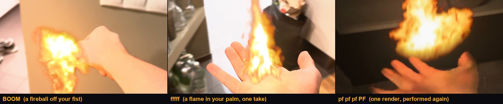
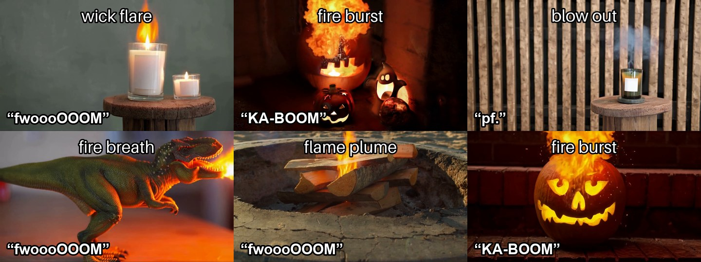
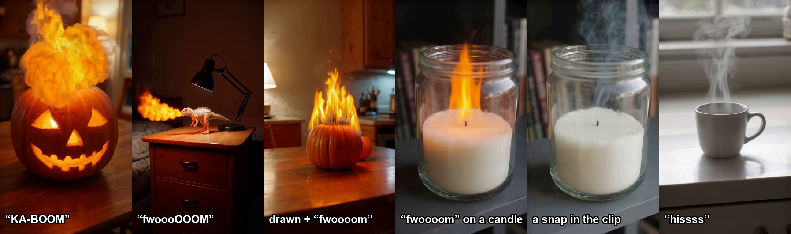
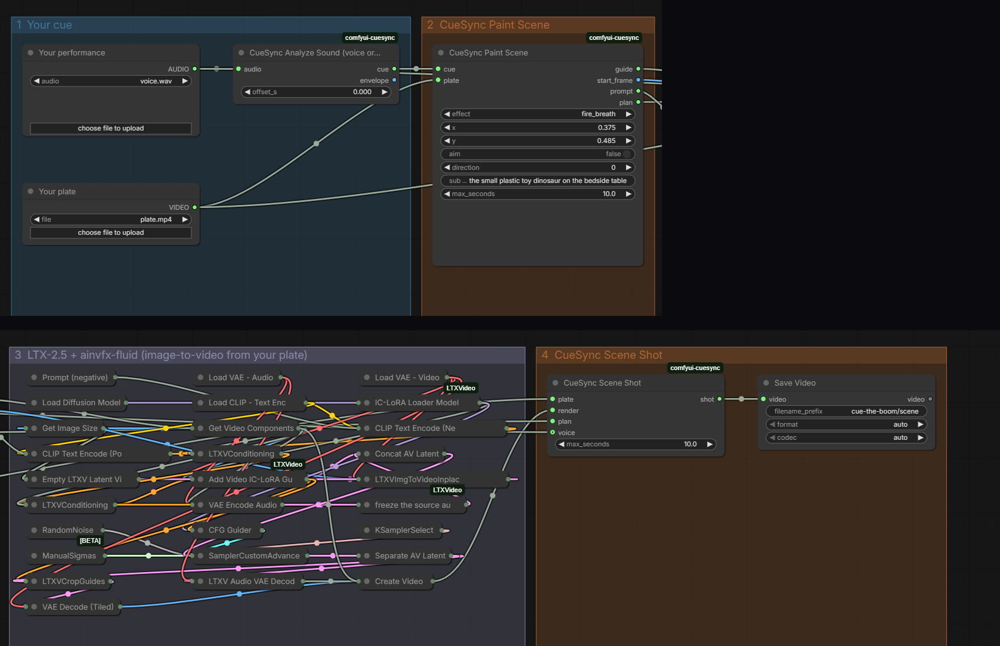
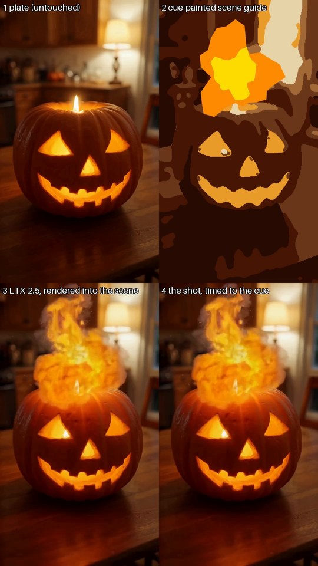
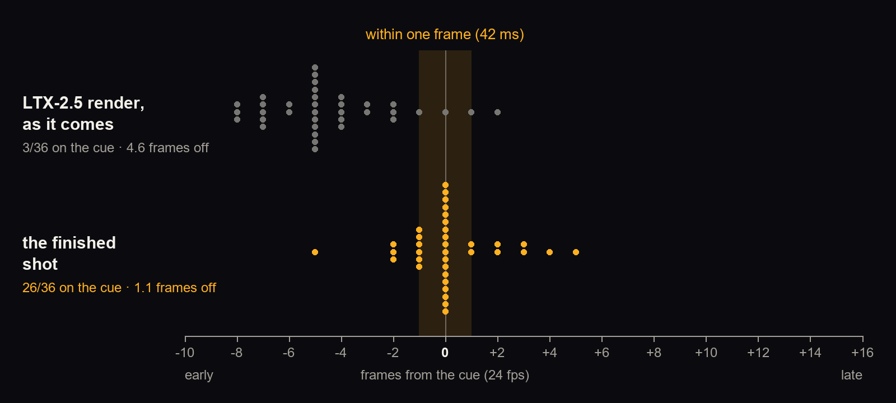

# Cue the Boom

**Film your hand. Make the noise. Throw fire.**

[Try it without a GPU](#try-it) · [From your hand](#from-your-hand-element-bending) · [How it works](#how-it-works) · [How well it lands](#how-well-it-lands)

Hold your hand up to the camera, tap your palm or fingertips, and make the noise:
- a hum charges an ember in your palm, and "BOOM" throws the fireball;
- a long "fffff" from pointed fingers is a flamethrower that whips through the air when you swing.

**LTX-2.5** with the **[ainvfx-fluid](https://huggingface.co/AInVFX/ainvfx-fluid)** IC-LoRA by AInVFX (Adrien Toupet) renders the fire once, over black. Cue the Boom tracks your hand and carries the fire on it frame by frame: what was already thrown keeps flying the way you threw it, your fingers hide its root, and it lights your skin. Then **perform it again**: a new rhythm on the same render, with no new render.


<sub>Real stock hands ([credits](samples/CREDITS.md)) with test voices. The fire is LTX-2.5 + ainvfx-fluid, rendered once over black and carried on the tracked hand.</sub>

Or tap or draw anything in your shot ("KA-BOOM" at a jack-o'-lantern, "fwoooOOOM" at a toy dinosaur) and LTX-2.5 renders the effect into the scene, so it lights the room and leaves its mark: a blown-out candle stays out. Each sound picks the effect and sets its frame, size and length. The render's real onset is then measured and moved onto your cue. On 57 test shots, 26 of them on real stock footage, 37 of 42 single hits land within a frame (42 ms) of the cue; straight from the model, none do.

**New here:** a generated effect becomes something you perform.
- Your sound (and your hand's gesture) picks it, times it and sizes it.
- Your hand carries it, with each part of the flame keeping the direction it was thrown in.
- A hum charges it.
- Performing it again re-times the same render, with no new generation.

The receipt of every shot records how far off the model was and what was measured.


<sub>Real stock clips and photos ([credits](samples/CREDITS.md)), each with the sound that cued it. Three are cued by real people's recorded voices, two of them with one source per hit (call and response). These shots play in the studio's gallery with no GPU.</sub>

An entry for Comfy's **Open Source Higgsfield** contest, built on the Comfy Developer Platform (the Comfy Python SDK against a self-hosted Comfy API), on open weights only.

## Why

Preset effects decide for you where and when the effect happens; prompt-based video edits make you type the timing ("at about 2.2 seconds, on his finger snap"). Cue the Boom keeps you in charge of the two things a shot is made of:

- **Where.** Your hand: your fingertips, your palm, wherever it goes. Or the thing in your shot it comes from: a toy's mouth or a candle's wick. Tap it and drag to aim it, or draw it (flames along the top of a pumpkin). For a rhythm, tap a different thing for each hit: "pf, pf, KA-BOOM" pops the little jack-o'-lantern, then the ghost, then blows up the big one (call and response).
- **When, and how much.** A sound pins the frame, and its loudness and length shape the effect. Your voice is the fun way to do it. The sound already in your clip is the editor's way, since hits are cut to sound anyway. Press-and-hold works in a quiet room.

In the scene, the effect is rendered into the shot, so it lights and changes what is around it. On a moving clip CueSync adds only what the effect changed and checks the result; if the check fails, the shot says so and uses the render. On 18 real moving clips, 14 kept their own pixels and 4 fell back to the render.

## Try it

You need Python 3.10+ (CI runs 3.12), and Node 24 for the studio.

**Firebending in two minutes, no GPU.** The sample hand ships with its fireball rendered ahead of time, and your take fires it:

```bash
git clone https://github.com/grzenio22/cue-the-boom && cd cue-the-boom
pip install "./cuesync[server]"
cuesync bend --plate samples/plates/hand_cupped.mp4 --voice samples/voices/pf-pf-ka-boom.wav \
  --again samples/made_ahead/bending/hand_cupped__kaboom__fire_burst --offset-s 0.6
```

`runs/bend/final.mp4` shows "pf, pf, KA-BOOM" as three fireballs in the palm, one on each beat, each as big as it was loud, with no new render. It takes about a minute on a laptop CPU. Swap in a recording of your own noise; a hum before the "BOOM" charges an ember first.

**The studio, no GPU.** In two terminals:

```bash
cuesync serve --instant-only           # terminal 1: the render API, http://127.0.0.1:8765
cd web && npm install && npm run dev   # terminal 2: the studio, http://localhost:3000
```

Pick **Your hand: cupped palm**, then **Perform it**. Choose a sample noise or use your microphone (hum, then BOOM), and **Make the shot**.

The scene shots in `samples/made_ahead` play straight away in the gallery, and you can drag their hit to re-time them in seconds. Your own take plays them too: say it or press and hold on a sample clip, and each of your hits plays the render made ahead of time, in about 20 s on the CPU. **Perform it again** does the same after any shot on a still plate. On your own clip, instant mode places pre-rendered LTX-2.5 elements, timed by your cue.

**Re-timing from the command line** (no npm): re-time a shipped scene shot, and re-measure the timing of the shipped shots.

```bash
cuesync retime --shot samples/made_ahead/scene/jackolantern_kitchen__ka-boom__fire_burst --plate samples/plates/jackolantern_kitchen.mp4 \
  --voice samples/voices/ka-boom.wav --effect fire_burst --x 0.48 --y 0.39 --shift 6 -o runs/retimed
python tools/measure_timing.py samples/made_ahead/scene -o runs/timing
```

`runs/retimed/final.mp4` is the shot moved a quarter of a second later, composited again from the same render; `runs/timing/timing.md` is the timing table for those shots.

In the studio:

1. Pick a sample shot or your own clip (phone held still, 1-15 s; the shot uses the first 10 s).
2. Tap where it comes from (or a different thing for each hit: **One thing per hit**), or draw it.
3. Cue it: say it into the microphone (or pick a sample noise), use the clip's own sound, or press and hold while it plays.
4. Make the shot. **Into the scene** renders it into your shot (GPU); **Instant** places a pre-rendered element (no GPU).

With the GPU offline, the studio's sample clips still play their scene shots made ahead of time, the drawn one included; each sample noise says whether it plays that render or makes an instant shot. The sample clips are stand-ins generated with LTX-2.5, picked so every feature can be tried without a camera: a drawing, a snap in the clip, a rhythm.



**From the command line:**

```bash
cuesync shot --instant --plate samples/plates/pumpkin_kitchen.mp4 --voice samples/voices/ka-boom.wav --effect fireball --x 0.5 --y 0.56
```

`runs/shot/` then holds `final.mp4` (the shot with a live ribbon of the cue), `breakdown.mp4` (plate | guide | render | shot), `composite.mp4` (the clean shot) and `receipt.json` (what was measured and what made it).

## Into the scene (GPU)

The full pipeline needs ComfyUI with LTX-2.5 22B (int8) and ainvfx-fluid. A render fits a 32 GB card (tested with the GPU held to 31.5 GiB free: about 3 minutes a render); we run it on a rented RTX PRO 6000 (96 GB), about a minute a render:

```bash
python infra/pod/podctl.py volume create                           # once: the network volume that keeps the models
python infra/pod/podctl.py up && python infra/pod/podctl.py setup && python infra/pod/podctl.py sync
python infra/pod/podctl.py tunnel                                   # in another terminal
pip install "./cuesync[server,comfy]"
export COMFY_BASE_URL=http://127.0.0.1:8189                         # the pod, for the commands below too
cuesync serve
```

`podctl` creates, sets up and terminates a disposable pod through the Runpod API; a watchdog terminates it when idle ([infra/pod/README.md](infra/pod/README.md)). A scene shot takes about two minutes, most of it the LTX-2.5 render.

From the command line, add `--scene`:

```bash
# the toy dinosaur breathes fire to the left, as long and as hard as your "fwoooom"
cuesync shot --scene --plate samples/plates/toy_desk.mp4 --voice samples/voices/fwoooom.wav --effect fire_breath \
  --x 0.375 --y 0.485 --direction -90 --subject "the small plastic toy dinosaur on the bedside table"
# lock it to the snap that is already in the clip
cuesync shot --scene --plate samples/plates/candle_snap.mp4 --cue clip --effect blow_out --x 0.53 --y 0.52
# draw it, time it with a hold, say what happens
cuesync shot --scene --plate samples/plates/pumpkin_kitchen.mp4 --cue hold --hold 1.0-2.5 --effect flame_plume \
  --strokes samples/strokes/pumpkin_top.json --describe "the small pumpkin catches fire and flames spread along its top"
```

**In ComfyUI.** [`workflows/cue_the_boom_scene.json`](workflows/cue_the_boom_scene.json) (drag it onto the canvas) is the whole scene shot as one workflow: your cue and your plate go in, the finished shot comes out. [`cue_the_boom_scene.api.json`](workflows/cue_the_boom_scene.api.json) is the same graph for the API.



Install: clone this repository and [ComfyUI-LTXVideo](https://github.com/Lightricks/ComfyUI-LTXVideo) into `ComfyUI/custom_nodes/` (or paste their URLs into ComfyUI-Manager's "Install via Git URL"), install this one's `requirements.txt` into ComfyUI's Python, and get the models in [build/model-files.md](build/model-files.md):

```bash
cd ComfyUI/custom_nodes
git clone https://github.com/Lightricks/ComfyUI-LTXVideo && pip install -r ComfyUI-LTXVideo/requirements.txt
git clone https://github.com/grzenio22/cue-the-boom && pip install -r cue-the-boom/requirements.txt
```

To try it on a sample, copy `samples/voices/fwoooom.wav` to `ComfyUI/input/voice.wav` and `samples/plates/toy_desk.mp4` to `ComfyUI/input/plate.mp4` and queue the workflow as it is: Paint Scene is set up for that toy dinosaur (x 0.375, y 0.485, breathing fire to the left). The nodes are documented in [comfyui-cuesync/README.md](comfyui-cuesync/README.md).

## From your hand (element bending)

Film your own hand, tap where the fire leaves it (fingertips, palm), drag to aim, and cue it: a long "fffff" from pointed fingers is a flamethrower, "KA-BOOM" from an open palm a fireball, a palm "hissss" steam, a "pf" a blast of air. The sound and the hand's gesture pick the effect; a tap on the badge changes it.

The element is rendered once over black with LTX-2.5 and ainvfx-fluid (the LoRA learned static sources, so the hand isn't regenerated). Then it is carried on your hand frame by frame:
- **Tracking:** MediaPipe and optical flow follow the hand you tapped.
- **History:** each part of the flame keeps the direction it was thrown in, so a swing whips through the air.
- **Matte:** a SAM 2.1 matte lets the fingers in front of the flame's root hide it.
- **Timing:** each hit fires on your arm's strike when the strike falls on the beat.
- **Light:** your hand is lit from where the fire is.
- **Charge-up:** hum before the strike ("mmmmmmBOOM") and an ember grows in your palm with your voice. It lights your fingers until the strike releases the fireball, and the hum launches nothing. The ember is the render's own first fire.
- **First person:** with the phone at your eyes and your hand coming in from below, a handheld camera is measured on the background, so what was already thrown moves with the room, not with the screen. A camera on a tripod is left alone. On a handheld stand-in with a known camera path, the error is 0.6 px median over the flame's 10-frame history, against 27 px of camera motion. Tripod shots, plain walls and a person walking past are all left still.

**Perform it again** plays the same render on a new rhythm, with no new render.

**Without a GPU:** pick the sample *Your hand: cupped palm* in the studio, perform any rhythm (or pick a sample noise), and its fireball, made ahead of time, fires on each of your hits (about a minute on a laptop CPU). `cuesync bend --again` does the same from the command line ([Try it](#try-it)).

**From the command line, on your own clip** (GPU and the two helper environments below):

```bash
cuesync bend --plate my_hand.mp4 --voice my_kaboom.wav --x 0.55 --y 0.6 --frame 40   # where on the hand, on frame 40
```

**On your own clip** it needs the GPU for the render (above), plus two helper environments the server runs as subprocesses. They live apart from `cuesync/.venv` because MediaPipe's opencv-contrib clashes with the core's opencv-python. From the repository root (on Linux and macOS the interpreter is `bin/python`):

```bash
# the hand tracker (MediaPipe + RTMPose, Apache-2.0; its models download on first use into ~/.cache/cuesync)
uv venv cuesync/.venv-track --python 3.12
uv pip install --python cuesync/.venv-track/Scripts/python.exe mediapipe==1.1.1 onnxruntime==1.31.0 av==19.0.1
# the hand matte (SAM 2.1-small, Apache-2.0; an NVIDIA GPU, CUDA 12.8 wheels, ~3 GB). Without it the flame's root
# fades out behind the fingertips instead.
uv venv cuesync/.venv-mask --python 3.12
export VIRTUAL_ENV="$PWD/cuesync/.venv-mask"
uv pip install torch==2.11.0 torchvision==0.26.0 --index-url https://download.pytorch.org/whl/cu128
uv pip install hydra-core==1.3.7 iopath==0.1.10 huggingface-hub==2.2.0 mediapipe==1.1.1 av==19.0.1 tqdm setuptools wheel
SAM2_BUILD_CUDA=0 uv pip install --no-build-isolation --no-deps "sam-2 @ git+https://github.com/facebookresearch/sam2.git@2b90b9f5ceec907a1c18123530e92e794ad901a4"
unset VIRTUAL_ENV
```

The same in PowerShell (Windows):

```powershell
uv venv cuesync/.venv-track --python 3.12
uv pip install --python cuesync\.venv-track\Scripts\python.exe mediapipe==1.1.1 onnxruntime==1.31.0 av==19.0.1
uv venv cuesync/.venv-mask --python 3.12
$env:VIRTUAL_ENV = "$PWD\cuesync\.venv-mask"
uv pip install torch==2.11.0 torchvision==0.26.0 --index-url https://download.pytorch.org/whl/cu128
uv pip install hydra-core==1.3.7 iopath==0.1.10 huggingface-hub==2.2.0 mediapipe==1.1.1 av==19.0.1 tqdm setuptools wheel
$env:SAM2_BUILD_CUDA = "0"; uv pip install --no-build-isolation --no-deps "sam-2 @ git+https://github.com/facebookresearch/sam2.git@2b90b9f5ceec907a1c18123530e92e794ad901a4"
Remove-Item Env:VIRTUAL_ENV, Env:SAM2_BUILD_CUDA
```

`cuesync serve` finds them there; `CUESYNC_TRACK_PY` and `CUESYNC_MASK_PY` point it at others.

A take that tracks well:
- **Light and background:** your hand lit, in front of a plain darker background.
- **Framing:** the whole hand in frame on the strike, with room for the flame in the direction it goes.
- **Camera:** 1080p at 24-30 fps, held still or steady. First person (the phone at your eyes, your hand coming in from below) works too.
- **Cue:** make your noise as you strike.

## How it works



1. **Read the cue** ([`cues.py`](cuesync/src/cuesync/cues.py), [`audio.py`](cuesync/src/cuesync/audio.py)). Onsets, the hits of a rhythm ("pf, pf, KA-BOOM"), an absolute loudness envelope per video frame, and when the sound is actually there. From your voice, from the clip's own soundtrack, or from press-and-hold. Its shape (a hit, a rhythm, a sustained sound, a breath, a hiss) picks the effect when you let it ([`gestures.py`](cuesync/src/cuesync/gestures.py)): a sample plate knows what it shows; on your own clip you say what it is (a candle, a jack-o'-lantern, a toy's mouth, a hot drink), since nothing here recognises objects. On a clip with no map of its own (your hand, a prop) the sound decides by what it is: a voiced boom bursts into flame, a voiced "fwoooOOOM" is a jet of fire (aimed) or a plume, a hiss is steam, an unvoiced "pf" blows out a flame that is already burning there or is a blast of air and smoke. (Voiced or not is read from pitch; an acoustic sound classifier alone, [`cue_detect.py`](cuesync/src/cuesync/cue_detect.py), misread too many of the 19 real and sample takes to pick with, so its reading is kept in the receipt for the record.)
2. **Paint the scene** ([`scene.py`](cuesync/src/cuesync/scene.py)). ainvfx-fluid was trained on controls that paint the whole frame in six flat colour zones, with the real first frame as conditioning. So CueSync paints your plate in its own zones on every keyframe and paints the effect over them: at its source, going its way (a jet out of a mouth that curls up as hot gas rises; a flare that grows out of the candle's own flame and settles back; steam aimed sideways as a jet, steam rising as wisps), or filling your drawing as far as your cue says. The words fit the subject ([`effects/`](effects)): a jack-o'-lantern's carved face flares, a creature breathes fire out of its mouth, a hand only shoots it from the fingertips, and a resting flame is painted only where one already burns. The scene is held over each 8-frame latent until the hit (a blank latent lets the model start the effect early), and every hit lands on a keyframe.
3. **Render into the scene.** LTX-2.5 image-to-video starts from your plate's frame at full strength, with the painted guide, through the Comfy SDK ([`runner.py`](cuesync/src/cuesync/runner.py)). The model lights the room, the table and the prop itself, and leaves what the effect leaves behind.
4. **Time it** ([`scene_shot.py`](cuesync/src/cuesync/scene_shot.py)). The first frame where the effect is visible is measured on the render and moved onto your cue (a burst shows a frame before its "BOOM": light beats sound). In a rhythm, each hit the model kept apart goes onto its own cue: the render plays up to a third faster or a quarter slower between them, and when not every hit can be reached, the big blast is the one that lands. In call and response each hit is measured at its own source. A blast adds a warm flash at its peak and a camera shake just after it.
5. **Keep your footage** ([`transfer.py`](cuesync/src/cuesync/transfer.py)). A still plate becomes the render. A moving clip keeps its own pixels when it can: the render and the clip are tracked onto the start frame, the render's exposure dip (LTX darkens a room by up to three stops for a fireball) is taken out before anything is compared, and its light carries over as a gain on your pixels, in linear light, so the room goes warm and dark around the fire while keeping its own texture; where the structure changed (the fire, smoke, debris) the render replaces the plate. The transfer is checked, and if the render moved or re-shaped the scene, the shot uses the render and says so: that happened on 4 of 18 real moving clips. With your hand in the shot (the subject says so: "the outstretched hand"), the hand and arm behind the source keep their own pixels, never replaced and left out of the camera tracking, and get only the fire's light, filled in from around them (the model re-draws a hand as it likes).

6. **Perform it again** ([`replay.py`](cuesync/src/cuesync/replay.py)). A finished shot's render already holds each hit's effect: its fire, its light on the scene, what it leaves behind. Taken from the render once (the same timing and transfer, without the camera's flash and shake), each becomes a response that a new take fires on its own hits, in seconds and with no new render: a new rhythm, another voice, "BOOM, pf, pf" instead of "pf, pf, BOOM" (with as many hits as the render, the loudest sound fires the biggest effect). **Perform all together** does it for several shots on one plate: tap the little jack-o'-lantern and say "pf", tap the big one and say "BOOM", and one rhythm then plays both, each effect at its own spot, one render each. (In a single call-and-response render, a fireball can drift over the next source and has to be shared out between them; one render per source keeps every effect whole.) It can't change an effect's shape or length, and works on still plates for now (a moving clip would need its camera held still).
7. **Give it its sound** ([`sfx_synth.py`](cuesync/src/cuesync/sfx_synth.py)). Procedural Foley of what the effect does (a fire's whoomph and crackle, a puff of smoke, a candle blown out), synthesised for the shot with each hit on the frame where it shows, sits under your cue.

Every shot writes a receipt: the cue, where the hits were painted, how early or late the model put them, how far they were moved, whether the transfer passed its check. LTX-2.5 can only take the guide on an 8-frame grid (a third of a second at 24 fps), and it nearly always starts the effect a few frames early, so this measure-and-move step is what puts the hit on your cue.

### How well it lands

Marked by eye frame by frame on the raw renders of 57 shots ([`tools/timing_annotations.json`](tools/timing_annotations.json), [`tools/measure_timing.py`](tools/measure_timing.py)):

| hits | within one frame (42 ms) of the cue: LTX-2.5 render as it comes → finished shot | mean error |
|---|---|---|
| all 66 | 7 → 53 | 5.2 → 1.1 frames |
| single hits (42) | 0 → 37 | 6.0 → 0.7 frames |
| hits in a rhythm (24), each on its own cue | 7 → 16 | 3.7 → 1.7 frames |
| hits on renders the onset code was not fitted on (46, on 39 renders) | 6 → 35 | 5.2 → 1.3 frames |
| real footage rendered after the last onset fix, synthetic noises (11) | 1 → 10 | 6.4 → 0.9 frames |
| real footage cued by real people's recorded voices, marked blind (12) | 3 → 6 | 5.3 → 2.5 frames |

The 57 shots are 31 on stand-in plates (11 setups, most rendered more than once: other seeds, and renders from before a fix) and 26 on real footage. Of the 76 hits painted, 66 have an onset that can be marked; the other 10 are 6 rhythm hits the model merged into a neighbour and 4 that can't be called: a start too faint to see, steam added to a cup's and a mug's own steam, and a candle the model never blew out. Counting those 10 as misses, 53 of 76 hits land within a frame. The onsets are marked by eye on the raw renders; the finished error is that mark moved by the shot's re-time, not a second look at the finished shot.

Every render the marks refer to ships with the repository (`samples/made_ahead/scene` and `samples/timing_set/`). The tool re-runs the pipeline's own onset and re-time code on every render rather than trusting the receipts (all 57 receipts agree with it), so the whole table re-measures from a clone in about five minutes:

```bash
python tools/measure_timing.py samples/made_ahead/scene samples/timing_set/before_fixes samples/timing_set/other_seeds samples/timing_set/dropped samples/timing_set/real
```

**On real footage.** 31 shots are on LTX-2.5 stand-in plates; 26 are on real stock clips and photos (Pexels, Pixabay, Wikimedia Commons). The first 7 real shots showed two misses the stand-ins never did: a real candle's flame flaring white as it was blown out read as already gone, and a whole real scene that LTX-2.5 re-shaped at a latent block boundary read as the effect starting. Both were fixed on those 7 (every stand-in render kept its onset). A second batch of 12 was then rendered and marked with no further change to the onset code: 8 of its 11 measurable hits landed within a frame, 7 of 8 single hits; the miss is a blast the model started inside the jack-o'-lantern's face, away from where it was painted. Putting each hit of a rhythm on its own cue came after (it has no fitted parameters) and brings that batch to 10 of 11; counting the 3 shots where the effect never showed as asked, 10 of 14. Of the 18 real moving clips, 14 keep their own pixels and 4 fall back to the render, each saying so (5 of 13 fell back before the transfer learned to follow a moving camera and to look past the render's exposure dip). The last 7 real shots are cued by real people's recorded voices (CC0 recordings from Freesound, cut into takes) and were marked blind by two annotators, a third deciding where they disagreed: 6 of their 12 hits land within a frame. The misses are the model's spacing, reported as they are: in two of the rhythms LTX-2.5 put the hits much further apart than the voice did (putting both on cue would mean playing the render 1.5 to 1.75 times as fast, beyond the third CueSync allows), and the lanterns' first pop flickered up 6 frames before the flame the measure caught. A take of the author's own voice on phone footage is next.



Before any of that, the take itself has to land where it was performed: [`tools/check_take_timing.py`](tools/check_take_timing.py) replaces the studio's microphone with a synthetic one that makes a noise at the moment the clip shows a chosen frame; in 8 takes the noise was found within 45 ms of it (6 within 20 ms). A synthetic microphone has no input latency; Chrome reports a real one's, and the studio subtracts it (where the browser doesn't say, it assumes 20 ms).

The limits, measured the same way: in a rhythm LTX-2.5 often merges close hits into one (6 of 30 here); those are reported, not faked, and each hit it keeps apart goes on its own cue. A flame dies down about 0.6 s after the voice stops (0.3 to 1.4 s).

**Element mode** (Advanced in the studio) is the other route: the effect is rendered alone on black and composited onto the untouched plate in linear light ([`composite.py`](cuesync/src/cuesync/composite.py)); the object stays in front through a GrabCut matte in the studio and the command line ([`matte.py`](cuesync/src/cuesync/matte.py)), or SAM 2.1 in the ComfyUI node.

## What is new, and what it builds on

What we found nobody else doing is the loop: a performed or in-clip sound becomes a hit frame and a growth curve, painted into an IC-LoRA control in the format the LoRA was trained on (the plate's own flat zones plus the effect), rendered by LTX-2.5 from the real plate frame, then the render's actual onset is measured and moved onto the cue, with the error written down; and for a moving clip, a checked transfer of only what changed. Each piece rests on prior work:

- **[ainvfx-fluid](https://huggingface.co/AInVFX/ainvfx-fluid)** (AInVFX, Adrien Toupet) is the painted-control fluid model everything here is rendered with. Its author describes painting over a photo as "inspired by" the photo, not a plate matcher; CueSync's zones, timing and transfer are what keep the shot yours.
- **Sound-guided video effects** have been studied before (for example [Soundini](https://arxiv.org/abs/2304.06818)); voice as a timing and loudness control exists for sound effects (vocal-imitation tools such as Sketch2Sound); audio-reactive and onset nodes exist for ComfyUI; LTX-2.5 has its own audio-to-video.
- **Drawing where an effect goes** and **scene reaction** exist in other tools (region edits, image-to-video effect presets). Here they are the inputs and the output of the cue, not the novelty.

## Repository

| Path | What |
|---|---|
| `cuesync/` | The Python core and CLI: cues, scene guides, the Comfy SDK runner, timing and transfer, the element compositor, the render API (Apache-2.0) |
| `cuesync/src/cuesync/bending.py`, `hand_track.py`, `hand_mask.py`, `fx_light.py` | Element bending: carrying a render on a tracked hand, the tracker, the matte, the fire's light on the hand |
| `comfyui-cuesync/` | ComfyUI node pack: Analyze Sound, Hold Cue, Paint Scene, Scene Shot, plus the element-mode nodes |
| `workflows/` | ComfyUI workflows, canvas (`*.json`) and API (`*.api.json`) format (LTX-2.x Community License, derived from the ainvfx-fluid sample) |
| `web/` | The studio (Next.js) |
| `effects/` | The effects, as JSON |
| `samples/` | Sample plates (stand-ins), noises (synthetic), the scene shots made ahead of time (on the stand-ins and on real footage, [credits](samples/CREDITS.md)), the timing evaluation renders and the instant-mode element library |
| `tools/` | Timing measurement, the take-timing check, the demo tools ([tools/README.md](tools/README.md)) |
| `infra/pod/` | Disposable Runpod GPU pods with a self-terminating watchdog |
| `build/model-files.md` | Exact models, licences and versions |

Tests: `pip install "./cuesync[server,dev]" && pytest cuesync/tests` (CPU only), plus `cd web && npm test`.

## Credits and licences

- **Code:** MIT, with `cuesync/` under Apache-2.0.
- **Workflows:** `workflows/` is under the LTX-2.x Community License (`workflows/LICENSE-LTX-2.x`).
- **Models:**
  - **LTX-2.5** by Lightricks (LTX-2.x Community License);
  - **ainvfx-fluid** by Adrien Toupet / AInVFX (LTX-2.x Community License): the painted-control fluid IC-LoRA this builds on;
  - **SAM 2.1** by Meta (Apache-2.0).
  - Rendered shots carry the LTX-2.x terms.
- **Software:** **ComfyUI** (GPL-3.0), the **Comfy Python SDK** and **comfy-api-proxy** by Comfy Org, **ComfyUI-LTXVideo** by Lightricks, **Next.js**, **PyAV/FFmpeg**, **OpenCV**.
- **Samples:** the sample noises (and the snap in `candle_snap.mp4`) are synthetic. The sample plates are stand-ins generated with LTX-2.5. The real-footage shots are made from stock clips and photos by the authors listed in [samples/CREDITS.md](samples/CREDITS.md) (Pexels License, Pixabay Content License, CC0 and public domain); only the processed shots are in the repository.
