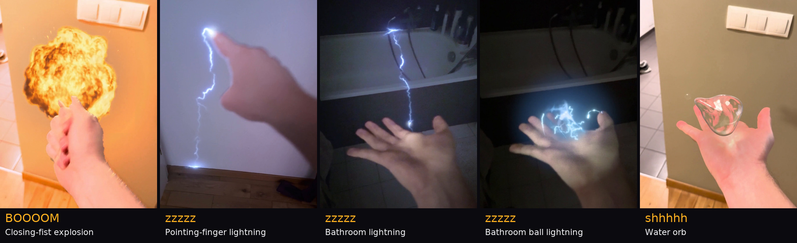

# Cue the Boom

**Generate the effect once. Perform it again with your voice.**

**Film your hand. Make the noise. Throw fire, lightning and water.**

Near the top of the studio, **One render. Three performances.** shows the author's palm and one LTX-2.5 fire render, performed with three takes of their own voice: **BOOM**, **pf, pf, BOOM**, and **pf pf pf PF**. Play them together or hear them one by one. A quiet "pf" makes a small hit; a loud "BOOM" makes a big one. Each take changes the timing and size without another generation or a GPU.

For hand effects, the fire and the explosion's fireball are rendered once over black by **LTX-2.5** with the **[ainvfx-fluid](https://huggingface.co/AInVFX/ainvfx-fluid)** IC-LoRA, in a ComfyUI workflow sent through the Comfy Python SDK. **Lightning and water are procedural CPU effects.** The CPU also handles the explosion's blast, compositing, light and smoke handling, using the stored LTX fireball.


<sub>The author's own hand and voice, filmed on a phone. The third is a render performed again in a new rhythm, with no new render.</sub>

An entry for Comfy's **[Open Source Higgsfield](https://comfy.org/open-source-higgsfield)** contest, on open weights only.

[Try it](#try-it-in-two-minutes-no-gpu) · [How it works](#how-it-works) · [The entry at a glance](#the-entry-at-a-glance) · [With a GPU](#with-a-gpu) · [In detail](TECHNICAL.md)

## Why it's new

The contribution is separating generation from performance: one generated effect becomes a reusable instrument.
Your voice controls when it hits, how big it plays and how long it burns.
A new take reuses the same element while the CPU tracks, masks, lights and composites it on your hand.
The three performances above the studio let you hear and see that separation.

## Try it in two minutes, no GPU

You need Python 3.10+ and git. No GPU and no model download: the studio ships built, and the sample hands come with their fire rendered ahead of time.

```bash
git clone --depth 1 https://github.com/grzenio22/cue-the-boom
cd cue-the-boom
python -m venv .venv
```

Activate the environment (Windows: `.venv\Scripts\activate`; macOS and Linux: `source .venv/bin/activate`), then:

```bash
pip install "./cuesync[server]"
cuesync studio
```

The studio opens at http://127.0.0.1:8765 (`cuesync studio --port 8766` if that port is taken). In it:

1. Pick **Your hand: open palm** (the author's hand).
2. Cue it: pick the sample noise **pf, pf, KA-BOOM** (synthetic), or **Use my microphone** and make your own noise while the clip plays.
3. **Make the shot**: the stored fire is timed and sized by your take, in about a minute on a laptop CPU (an explosion takes a few).
4. **Perform it again** with another rhythm: the same fire, no new render.

Under **Made with it**, play **fffff · a flame in the palm, one take**: the camera walks from a hallway into a kitchen, and the flame stays in the palm. To perform it yourself, pick **Your hand: a flame through the house**, then **Use my microphone** and hold an "fffff".

**Your own hand:** use **Film it here** or **Use your own clip**, then **Set up the hand tracker** once (needs Python 3.12 or `uv`). Tap your palm or fingertips, drag to aim, and confirm **That's my hand**. Record your noise and **Make the shot**. **Try it live** previews stored fire and procedural lightning through your webcam. It needs internet access to load its hand model and runtime from a CDN. **Record this** turns the take into a finished shot. [Tracking and live-preview details](TECHNICAL.md#the-hand-element-bending).

The same from the command line (the shot lands in `runs/bend/final.mp4`):

```bash
cuesync bend --plate samples/plates/hand_palm.mp4 --voice samples/voices/pf-pf-ka-boom.wav --again samples/made_ahead/bending/hand_palm__boom__fire_burst
```


## How it works


1. **Your sound** sets when each hit fires, how big it is and how long it lasts. With your hand's gesture, it also picks the effect.
2. **Your hand** is followed by MediaPipe and RTMPose. SAM 2.1 supplies the matte with a GPU; the CPU route uses MediaPipe's skin segmenter and hand landmarks.
3. **The fire** is rendered once, over black, by LTX-2.5 with the ainvfx-fluid IC-LoRA in a ComfyUI workflow, from a guide your sound paints.
4. **Carried, lit, timed:** the fire follows your hand, lights your skin, passes behind your fingers and fires on every hit. A thrown fireball keeps moving after your hand pulls back.
5. **Perform it again:** a new take re-composites the same render in about a minute on a CPU (an explosion takes a few). A held flame burns as long as your new voice holds it.

**Or tap anything in your shot.** "KA-BOOM" at a jack-o'-lantern, "fwoooOOOM" at a toy dinosaur: LTX-2.5 renders the effect into the scene, so it lights the room and leaves its mark.

For scene renders, Cue the Boom measures where the effect starts and moves it onto your sound. On 42 single hits, 37 land within one frame (1/24 s) of the cue; straight from the model, none do. [Evaluation and limits](TECHNICAL.md#how-well-it-lands).


<sub>Real stock clips and photos ([credits](samples/CREDITS.md)), each with the sound that cued it. These play in the studio's gallery with no GPU.</sub>

The details (the pipeline step by step, the timing evaluation, the matte, the light) are in [TECHNICAL.md](TECHNICAL.md).

## Beyond fire: lightning, water and an explosion

The gallery includes an explosion on a closing fist, lightning from a pointing finger, lightning and ball lightning in the dark bathroom, and a water orb. These are the author's phone footage, cued with synthetic sample noises:



Pick **Your hand: palm to fist**, **Your hand: open palm, lit room**, or another sample hand, then a noise:

- **zzzzz · tsst!**: lightning channels or ball lightning, with light on the hand and room.
- **BOOOOM**: the stored LTX fireball, with CPU blast, shock front, light and smoke compositing.
- **shhhhh · sploosh**: a water orb or whip that refracts the room.

Use **Choose it yourself** under Make the shot to pick a form, or record your own noise. It also offers experimental air effects: their look is unfinished and they have no gallery shot. A buzz can select lightning, and a long BOOM with a punch can select an explosion. These run on your own clip without a GPU or another generation. [How the CPU effects work](TECHNICAL.md#lightning-water-air-and-an-explosion).

## The entry at a glance

- **Core video model:** LTX-2.5 (Lightricks) with the ainvfx-fluid IC-LoRA (AInVFX, Adrien Toupet). Every fire effect, and the explosion's fireball, is an LTX-2.5 render.
- **Open weights only, self-hosted.** No partner nodes and no closed APIs. [Models and licences](TECHNICAL.md#models-and-licences); [versions and revisions](build/model-files.md).
- **The app:** a browser studio and its render API (`cuesync studio`), a CLI (`cuesync`), and ComfyUI nodes.

## Comfy Developer Platform

The app is written to the Comfy Python SDK and Comfy API v2 exposed by the Comfy Developer Platform. The [runner](cuesync/src/cuesync/runner.py) submits workflow JSON through the SDK.

- **Hosted platform:** set `COMFY_API_KEY`. With `COMFY_BASE_URL` unset, the SDK defaults to `https://cloud.comfy.org`. For `cuesync studio`, also set `COMFY_BASE_URL=https://cloud.comfy.org`; GPU rendering is offered only if the endpoint's unauthenticated `/api/v2/health` check returns HTTP 200.
- **Self-hosted ComfyUI:** run comfy-api-proxy in front of ComfyUI and set `COMFY_BASE_URL` to the proxy URL, for example `http://127.0.0.1:8189`. `COMFY_API_KEY` supplies the SDK's authentication and can be unset for a proxy that needs none.

The renders here ran on self-hosted ComfyUI to load the ainvfx-fluid IC-LoRA and install the [CueSync node pack](comfyui-cuesync). A target server needs the models and nodes used by the workflow.

## With a GPU

To generate a new hand element or render into a scene, use ComfyUI with LTX-2.5 22B (int8) and ainvfx-fluid. A render fits a 32 GB card (about 3 minutes); on a rented RTX PRO 6000 (96 GB) it takes about a minute. [Local and rented GPU setup](TECHNICAL.md#with-a-gpu), including the Comfy SDK connection and model downloads.

## Repository

| Path | What |
|---|---|
| `cuesync/` | The Python core, the CLI and the render API: cues, guides, the Comfy SDK runner, timing, the compositor, the hand (Apache-2.0) |
| `web/` | The studio (Next.js); built into `cuesync/src/cuesync/studio_static/` |
| `comfyui-cuesync/` | The ComfyUI node pack |
| `workflows/` | The ComfyUI workflows, canvas and API format (LTX-2.x Community License, derived from the ainvfx-fluid sample) |
| `effects/` | The effects, as JSON |
| `samples/` | The sample clips and noises, the shots made ahead of time, the timing evaluation renders, the element library ([credits](samples/CREDITS.md)) |
| `tools/`, `infra/pod/` | Timing measurement, the demo tools; disposable GPU pods |

## Credits and licences

- **Code:** [MIT](LICENSE), with [`cuesync/` under Apache-2.0](cuesync/LICENSE). The workflows are under the [LTX-2.x Community License](workflows/LICENSE-LTX-2.x), and LTX-rendered shots carry its terms. See [NOTICE.md](NOTICE.md) for exceptions and third-party notices.
- **Models:** LTX-2.5 and ainvfx-fluid are open weights under the LTX-2.x Community License; the LTX-2.5 download is gated by a click-through on Hugging Face. [Files, versions and revisions](build/model-files.md).
- **Software:** ComfyUI (GPL-3.0); the Comfy Python SDK and comfy-api-proxy (Comfy Org); ComfyUI-LTXVideo (Lightricks); Next.js; PyAV/FFmpeg; OpenCV.
- **Demo narration:** Kokoro-82M (Apache-2.0), a synthetic narration voice used in the demo video; it is not part of the app. The performed fire cues are the author's own recorded voice.
- **Footage and sounds:**
  - `hand_palm`, `hand_point`, `hand_walk`, `hand_punch`, `hand_fist` and `hand_open` are the author's own hand and voice.
  - `hand_cupped` is a Pexels clip (Kindel Media).
  - The other sample clips are stand-ins generated with LTX-2.5. The preset noises are synthetic except **pf, pf, BOOM** and **pf pf pf PF**, which are the author's recordings. The five beyond-fire gallery shots use synthetic noises over the author's footage.
  - The real-footage scene shots are made from stock clips and photos, and real people's CC0 voices, by the authors in [samples/CREDITS.md](samples/CREDITS.md). Only the processed scene shots are in the repository; the Pexels hand clip ships as-is.
