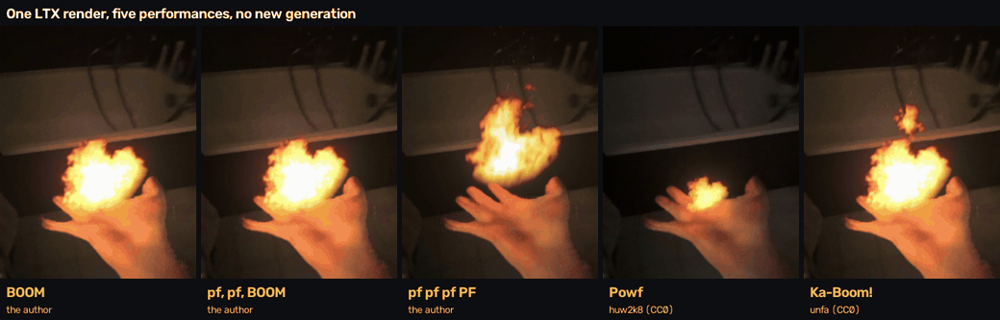
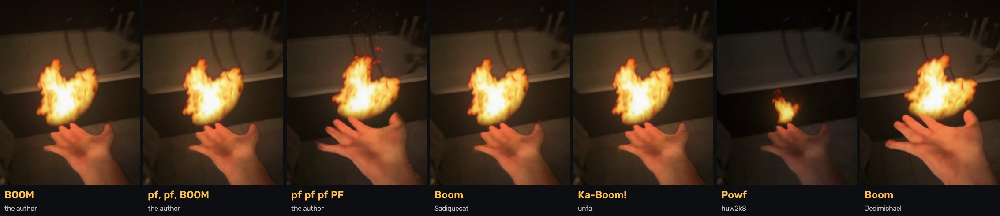
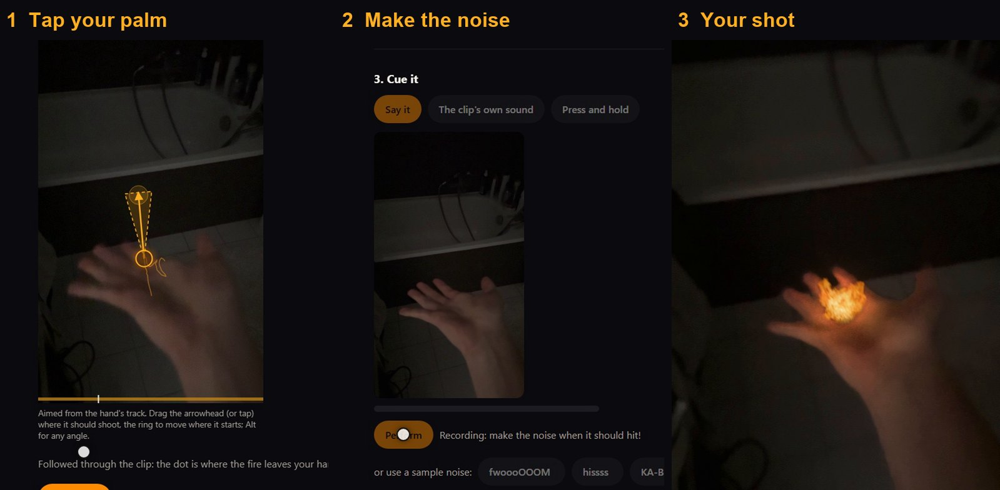
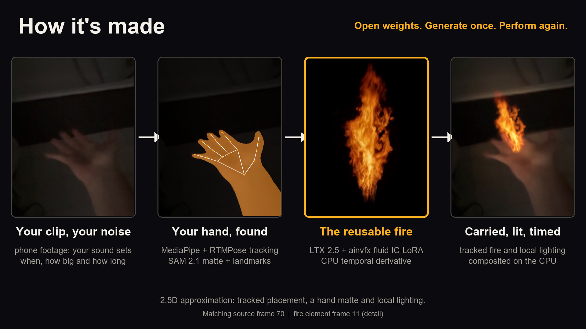

# Cue the Boom

**Generate the effect once. Perform it again with your voice.**


<sub>One stored LTX render, five recorded performances by three people: when it fires and how big it plays come from the voice.</sub>

Higgsfield's Effects presets, such as Fire Element, Air Bending, Explosion and Thunder God, generate a new clip every time. Cue the Boom rebuilds effects like these on open weights in ComfyUI and makes them performable: LTX-2.5 renders the fire once, then your voice plays it on your own hand, on a filmed clip or live through your webcam, as often as you like, with no new generation.

[Try it, no GPU](#try-it-on-your-computer-no-gpu) · [Try it live](#try-it-live-with-your-webcam) · [Why it's new](#why-its-new) · [How it works](#how-it-works) · [In ComfyUI](#comfyui-and-the-comfy-developer-platform) · [In detail](TECHNICAL.md)


<sub>The author's own hand and voice, filmed on a phone. The third is a render performed again in a new rhythm, with no new render.</sub>

The fire, the air vortex and the explosion's fireball are rendered once over black by **LTX-2.5** with the **[ainvfx-fluid](https://huggingface.co/AInVFX/ainvfx-fluid)** IC-LoRA, in a ComfyUI workflow sent through the Comfy Python SDK. **Lightning is a procedural CPU effect**, and the CPU makes the explosion's blast and does the compositing and light. An entry for Comfy's **[Open Source Higgsfield](https://comfy.org/open-source-higgsfield)** contest, on open weights only.

## Why it's new

The contribution is separating generation from performance. Sound-driven generation makes a new video for every sound; here one LTX-2.5 render becomes an instrument. Your voice decides when it hits, how big it plays and how long it burns, while the CPU tracks, masks, lights and composites the same element on your hand.

In the studio, **One render. Seven performances.** plays the proof: one LTX-2.5 fire render on the author's palm, performed three times by the author's recorded voice (the original BOOM, and two rhythms edited from the author's recorded pf and BOOM) and four more times by strangers' CC0 voices from Freesound. [Audio provenance](samples/CREDITS.md#the-authors-voice-and-the-three-performances).

For renders into a scene, the [CueSync node pack](comfyui-cuesync/README.md) takes the same idea into ComfyUI: it paints the sound into the guide video the ainvfx-fluid IC-LoRA follows, then measures where the render's effect starts and moves it onto the cue.


<sub>One generation, seven performances, each at its loudest hit: a breathy puff throws a small fireball, a boom a big one. Each also has its own timing and rhythm, which a still can't show.</sub>

## Try it on your computer, no GPU

You need git and Python 3.10 or newer (3.12 recommended; on a Mac, macOS 14 or newer). No GPU and no model download: the studio ships built, and the sample hands come with their fire rendered ahead of time. `--depth 1` downloads about 300 MB (about 560 MB on disk); the full history is about 1.4 GB.

macOS and Linux:

```bash
git clone --depth 1 https://github.com/grzenio22/cue-the-boom
cd cue-the-boom
python3 -m venv .venv
.venv/bin/pip install "./cuesync[server]"
.venv/bin/cuesync studio
```

Windows:

```powershell
git clone --depth 1 https://github.com/grzenio22/cue-the-boom
cd cue-the-boom
python -m venv .venv
.venv\Scripts\pip install "./cuesync[server]"
.venv\Scripts\cuesync studio
```

The `python3` built into macOS is 3.9, too old: install a newer one from python.org or Homebrew first. Debian and Ubuntu also need `sudo apt install python3-venv`.

The studio opens at http://127.0.0.1:8765 (`cuesync studio --port 8766` if that port is taken). In it:

1. Choose **Fire**, **Air**, **Explosion** or **Lightning**, then a form where offered. Click **Perform this … with your voice** to select its prepared hand clip.
2. Click **Use my microphone**, then **Record & make …**. Make the suggested sound as the clip plays. Microphone access starts only when you request it.
3. When recording ends, the app automatically makes your performance. Fire, air and explosion reuse stored generated elements; lightning is composed procedurally from your recording and the tracked hand. **Download** saves the finished shot.
4. **Perform again** gives the same element a new performance. No microphone? **Try a sample voice instead** performs it with a recorded example, labelled as one.

The prepared fire path always reuses the stored element, even when a GPU is connected. On a Ryzen 9 7900X, the bundled three-hit author rhythm took 40.3–40.8 seconds from HTTP submission through MP4 download (three runs; 84 frames at 24 fps; no new model generation). Those measurements exclude microphone permission and recording time and do not predict hosted or arbitrary-clip performance. Run `python tools/benchmark_prepared_palm.py --out runs/palm-benchmark` (it also needs `pip install httpx` and FFmpeg on your PATH) to measure the bundled author rhythm on your computer; it uses a separate local CPU-only server and writes its inputs, timings and decode checks.

### Try it live, with your webcam

On the start page, click **Try it live with your webcam** and allow the camera and the microphone. Hold an open palm up to the webcam and say BOOM: the stored LTX-2.5 fire bursts from your palm as you make the sound. A held fffff keeps a flame in it, and a buzzing zzzzz throws lightning. The preview loads its hand model and runtime from a CDN, so it needs internet access.

**Record this** keeps up to 8 seconds and turns the take into a finished shot on the CPU: your hand followed, matted and lit, with a hit for each of your four loudest sounds. The first time, the studio offers **Set up the hand tracker** (it needs Python 3.12 to 3.14, or [`uv`](https://docs.astral.sh/uv/); on a Mac, Apple Silicon, since its MediaPipe and ONNX Runtime builds don't exist for Intel Macs). On the same Ryzen 9 7900X, with a sample hand clip played as the webcam, an 8-second take was followed in 21 seconds and made into its fireball shot in 85 seconds; a 5-second take took 15–23 and 67–70 seconds. No GPU render runs.

**Your own clip:** open **Use your own clip or explore effects**, then **Film it here** or **Use your own clip**. Tap your palm or fingertips, drag to aim, confirm **That's my hand**, then record your noise and **Make the shot**. [Tracking and live-preview details](TECHNICAL.md#the-hand-element-bending).

Under **Made with it**, play **fffff · a flame in the palm, one take**: the camera walks from a hallway into a kitchen, and the flame stays in the palm. To perform it yourself, pick **Your hand: a flame through the house**, then **Use my microphone** and hold an "fffff".

The same from the command line (the shot lands in `runs/bend/final.mp4`):

```bash
cuesync bend --plate samples/plates/hand_palm.mp4 --voice samples/voices/pf-pf-ka-boom.wav --again samples/made_ahead/bending/hand_palm__boom__fire_burst
```



## How it works



1. **Your sound** sets when each hit fires, how big it is and how long it lasts. With your hand's gesture, it also picks the effect.
2. **Your hand** is followed by MediaPipe and RTMPose. SAM 2.1 supplies the matte with a GPU; the CPU route uses MediaPipe's skin segmenter and hand landmarks.
3. **The fire** is rendered once, over black, by LTX-2.5 with the ainvfx-fluid IC-LoRA in a ComfyUI workflow, from a guide your sound paints.
4. **Carried, lit, timed:** the fire follows your hand, lights your skin, passes behind your fingers and fires on each hit it hears (up to four in a take, at least a quarter of a second apart). A thrown fireball keeps moving after your hand pulls back.
5. **Perform it again:** a new take re-composites the same render on the CPU. A held flame burns as long as your new voice holds it; longer holds and overlapping hits take more time to process.

**Or tap anything in your shot.** "KA-BOOM" at a jack-o'-lantern, "fwoooOOOM" at a toy dinosaur: LTX-2.5 renders the effect into the scene, so it lights the room and leaves its mark.

For scene renders, Cue the Boom measures where the effect starts and moves it onto your sound. On 42 single hits, 37 start within one frame (1/24 s) of the frame they aim for, which for a burst is one frame before the sound; straight from the model, none do. [Evaluation and limits](TECHNICAL.md#how-well-it-lands).


<sub>Real stock clips and photos ([credits](samples/CREDITS.md)), each with the sound that cued it. These play in the studio's gallery with no GPU.</sub>

The details (the pipeline step by step, the timing evaluation, the matte, the light) are in [TECHNICAL.md](TECHNICAL.md).

## The curated gallery

**Made with it** leads with the fist explosion, the palm fire and its two new voice rhythms, the same render in four strangers' recorded voices, then the walking flame, pointing fire, the air vortex and lightning, whose procedural light falls on the author's hand. The grid shows each render once; its further performances play together under **One render. Seven performances.** These are finished shots you can play without a GPU.

Water and earth, and the procedural air ball and blast, are experimental CPU effects under the collapsed **Experimental** disclosure; their materials and motion can still look synthetic.

Choose an effect, then perform its cue. Voice controls timing and strength; it does not generate arbitrary new effects from spoken instructions. The live webcam preview supports fire and lightning. [Footage and audio credits](samples/CREDITS.md).

## The entry at a glance

- **Core video model:** LTX-2.5 (Lightricks) with the ainvfx-fluid IC-LoRA (AInVFX, Adrien Toupet). Every fire effect, the air vortex and the explosion's fireball are LTX-2.5 renders, and LTX-2.5 also renders effects straight into a shot: 28 scene shots ship ready to play, 18 of them on real stock footage, each started on its cue.
- **Open weights only, self-hosted.** No partner nodes and no closed APIs. [Models and licences](TECHNICAL.md#models-and-licences); [versions and revisions](build/model-files.md).
- **The app:** a browser studio and its render API (`cuesync studio`), a CLI (`cuesync`), and ComfyUI nodes.

## ComfyUI and the Comfy Developer Platform

- **The workflow:** [`workflows/fluid_element.api.json`](workflows/fluid_element.api.json) renders an element over black with LTX-2.5 and ainvfx-fluid; [`workflows/cue_the_boom_scene.json`](workflows/cue_the_boom_scene.json) is a whole scene shot on the canvas. The [ComfyUI screenshot](TECHNICAL.md#in-comfyui) carries its workflow: drag the picture onto the canvas to open the graph.
- **The node pack:** [CueSync](comfyui-cuesync/README.md) adds seven nodes: Analyze Sound and Hold Cue turn a performance into a cue, Paint Scene and Paint Guide paint it into the guide the IC-LoRA follows, Scene Shot moves the render's measured start onto the cue, and Object Matte and Composite finish element shots.
- **No GPU in ComfyUI:** [`workflows/cue_the_boom_retime_demo.json`](workflows/cue_the_boom_retime_demo.json) runs the node pack on the LTX-2.5 render the repository ships, in about 20 seconds on a CPU: Scene Shot finds the fire 5 frames early and moves it onto the cue. [How to run it](TECHNICAL.md#in-comfyui).
- **The SDK:** the app builds the workflow and runs it with the Comfy Python SDK ([runner](cuesync/src/cuesync/runner.py)), against Comfy Cloud (`COMFY_API_KEY`, `COMFY_BASE_URL=https://cloud.comfy.org`) or against self-hosted ComfyUI behind comfy-api-proxy (`COMFY_BASE_URL`, for example `http://127.0.0.1:8189`). The studio checks the target's nodes and models before it offers GPU modes. [Connection and preflight details](TECHNICAL.md#with-a-gpu).

The renders here ran on self-hosted ComfyUI, which loads the ainvfx-fluid IC-LoRA and the node pack.

## With a GPU

To generate a new hand element or render into a scene, use ComfyUI with LTX-2.5 22B (int8) and ainvfx-fluid. A render fits a 32 GB card (about 3 minutes); on a rented RTX PRO 6000 (96 GB) it takes about a minute. [Local and rented GPU setup](TECHNICAL.md#with-a-gpu), including the Comfy SDK connection and model downloads.

## Repository

| Path | What |
|---|---|
| `cuesync/` | The Python core, the CLI and the render API: cues, guides, the Comfy SDK runner, timing, the compositor, the hand (Apache-2.0) |
| `web/` | The studio (Next.js); built into `cuesync/src/cuesync/studio_static/` |
| `comfyui-cuesync/` | The ComfyUI node pack |
| `workflows/` | The ComfyUI workflows, canvas and API format (LTX-2.x Community License, derived from the ainvfx-fluid sample) |
| `effects/` | The effects, as JSON |
| `samples/` | The sample clips and noises, the shots made ahead of time, the timing evaluation renders, the element library ([credits](samples/CREDITS.md)) |
| `tools/`, `infra/pod/` | Timing measurement, the demo tools; disposable GPU pods |

## Credits and licences

- **Code:** [MIT](LICENSE), with [`cuesync/` under Apache-2.0](cuesync/LICENSE). The workflows are under the [LTX-2.x Community License](workflows/LICENSE-LTX-2.x), and LTX-rendered shots carry its terms. See [NOTICE.md](NOTICE.md) for exceptions and third-party notices.
- **Models:** LTX-2.5 and ainvfx-fluid are open weights under the LTX-2.x Community License; the LTX-2.5 download is gated by a click-through on Hugging Face. [Files, versions and revisions](build/model-files.md).
- **Software:** ComfyUI (GPL-3.0); the Comfy Python SDK and comfy-api-proxy (Comfy Org); ComfyUI-LTXVideo (Lightricks); Next.js; PyAV/FFmpeg; OpenCV.
- **Demo narration:** Kokoro-82M (Apache-2.0), a synthetic narration voice used in the demo video; it is not part of the app. The performed fire cues use the author's recorded voice, including the two edited rhythms described above.
- **Footage and sounds:**
  - `hand_palm`, `hand_point`, `hand_walk`, `hand_punch`, `hand_fist` and `hand_open` are the author's own hand and voice.
  - `hand_cupped` is a Pexels clip (Kindel Media).
  - The other sample clips are stand-ins generated with LTX-2.5. The preset noises are synthetic except **pf, pf, BOOM** and **pf pf pf PF**, which are edited rhythms made from the author's recordings, and four strangers' CC0 recordings (Sadiquecat, unfa, huw2k8, Jedimichael). The procedural lightning examples use synthetic noises over the author's footage.
  - The real-footage scene shots are made from stock clips and photos, and real people's CC0 voices, by the authors in [samples/CREDITS.md](samples/CREDITS.md). Only the processed scene shots are in the repository; the Pexels hand clip ships as-is.
